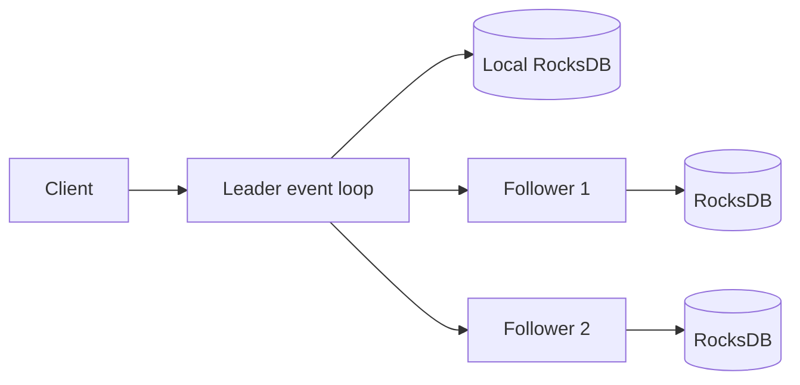

# Architecture and correctness boundaries

## State and concurrency

Each node owns one POSIX TCP listener. One event loop handles elections, heartbeats, incoming requests, replication, and commit advancement. RocksDB runs its own background work. There is no application mutex protecting Raft state because only one thread accesses it. A slow RPC or client can delay the loop; socket timeouts bound individual send/receive calls, not entire frames or arbitrary OS scheduling delays.

Durable state consists of `state` metadata (node/configuration identity, current term, voted-for, commit index, last log index), `log/<index>` entries, and `kv/<key>` values. Changed suffix entries and deletions, metadata, and committed PUT/DELETE effects are written in one RocksDB WriteBatch with `sync=true`. Recovery opens RocksDB, restores metadata, and loads the retained log; key state is already committed atomically. A RocksDB write error terminates the process instead of allowing it to acknowledge volatile state. Storage assumes the filesystem/device honors synchronous writes.

## Elections

Followers choose randomized 900–1700 ms deadlines. Candidates increment and persist their term and self-vote before RequestVote. A voter persists its vote before replying and checks the candidate's `(lastLogTerm, lastLogIndex)` lexicographically. A majority elects the leader. Every leader appends a current-term no-op. Higher-term messages force a durable term update and follower transition.

## Replication and commits

Leaders maintain nextIndex and matchIndex per follower. AppendEntries includes the preceding index/term, at most 32 entries, and the leader's commit index. Followers reject missing/mismatched predecessors, remove conflicting uncommitted suffixes, durably append entries, then acknowledge. Leaders back up nextIndex after rejection and retry on a later heartbeat. Committed entries cannot be overwritten. Only a majority-replicated entry from the leader's current term directly advances commit; its prefix commits with it. Follower commit advancement is bounded by the last entry matched in that RPC.

Heartbeats are nominally 80 ms and socket send/receive timeouts 180 ms. These are lab defaults, not configurable production timing policies. Peer attempts are sequential; loss of one peer adds latency to healthy quorum operations.

## Linearizable reads

GET is appended as a log entry and committed like a write. All preceding committed changes are applied before reading RocksDB. This provides a majority barrier even if an old isolated leader still considers itself leader. It costs disk space, synchronous writes, and a replication round per read; a production implementation would normally use a carefully implemented ReadIndex path. Diagnostics are local and have no linearizability guarantee.

## Failure model and scope

Crash-stop/restart nodes and lost peer communication are supported. The partition test drops all Raft traffic at one node using a diagnostic endpoint; it does not use kernel packet filtering. SIGKILL tests exercise process crashes, not power loss or device faults. The tests validate specific scenarios and are not a formal proof or exhaustive linearizability checker. Malicious or Byzantine peers, arbitrary disk corruption, and inconsistent membership are outside the model.

IDs and peer endpoint maps are checked against persisted metadata on restart. Operators must provide mutually consistent membership across all nodes; there is no discovery or membership negotiation. Endpoint changes need a fresh lab cluster. Single-node mode works, but provides no replication fault tolerance.

## Source map

- `src/main.cpp`: TCP framing, RocksDB durability, Raft state machine, server, CLI.
- `scripts/cluster.py`: local cluster lifecycle and configuration generation.
- `tests/cluster.py`: process-level election, CRUD, partition, divergence, crash, restart, quorum-loss checks.
- `scripts/benchmark.py`: concurrent client measurements.
- `scripts/profile-linux.sh`: CPU, lock, and Callgrind entry points.

## Extension plan

Extract transport/storage/Raft interfaces; add a deterministic simulated network and history-based linearizability checking; implement snapshots and bounded memory; add request IDs and deduplication; introduce asynchronous parallel replication and batching; add ReadIndex, TLS, membership changes, metrics, and production configuration validation. Each changes correctness obligations and should receive dedicated tests.
